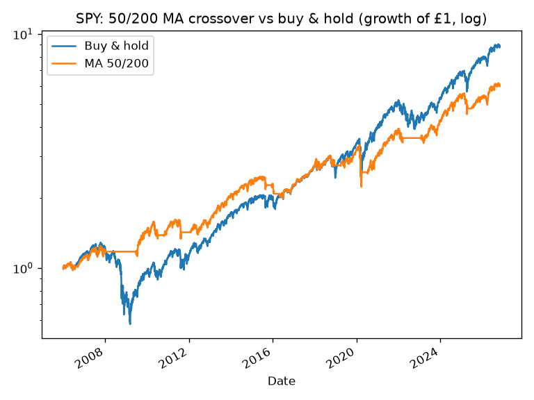
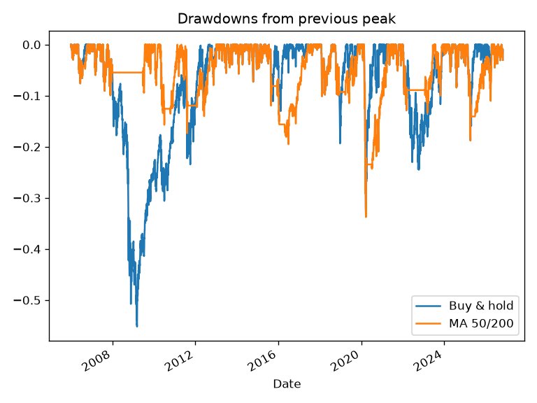
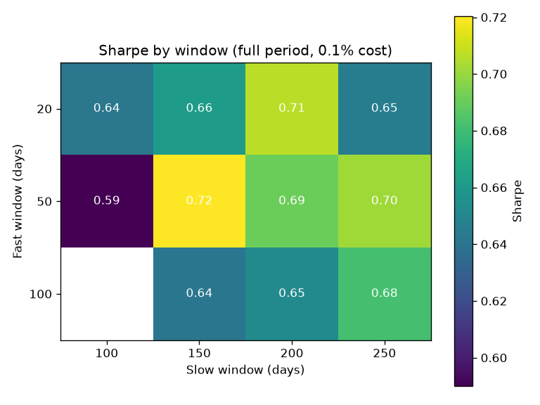
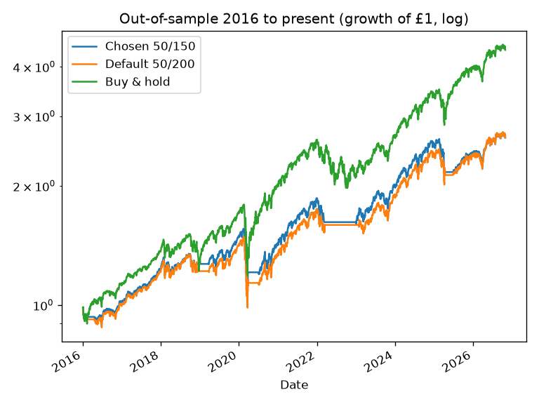

# SPY Moving-Average Crossover: an honest backtest

A simple momentum strategy on SPY (the ETF tracking the S&P 500): hold SPY when its 50-day moving average is above its 200-day moving average, otherwise sit in cash. Tested against plain buy & hold from 2005 to October 2026, with costs, a parameter grid, an out-of-sample test, other tickers, and a lookahead-bias check.

> Educational data-science project. Not financial advice. Past performance isn't a guide to future returns.

## How to run
```bash
python -m venv .venv && source .venv/bin/activate
pip install -r requirements.txt
python ma_crossover.py   # prints tables, writes results.md and charts/
```

## Method
1. **Download** daily prices with `yfinance` (`auto_adjust=True` adjusts for splits and dividends).
2. Load them into a pandas **DataFrame**, then **squeeze** the Close column into a plain Series.
3. **Rolling means**: 50-day and 200-day moving averages (`.rolling(n).mean()`).
4. **Signal**: 1 if the 50-day average is above the 200-day average, otherwise 0.
5. **Shift** the signal by one day (`.shift(1)`), so each day's trade only uses information available at the previous close. This avoids lookahead bias.
6. **Returns**: daily % change of the ETF (`.pct_change()`), multiplied by the signal.
7. **Costs**: 0.1% taken off only on days we trade (`.diff().abs()` marks buys and sells).
8. **Compound** with `.cumprod()` to get the growth of £1.
9. **Plot** and compare against buy & hold, using CAGR, annualised volatility, Sharpe ratio (risk-free rate = 0), maximum drawdown, time in market and number of trades.

All strategies are scored over the same period, starting when the longest window (250 days) is available (29 Dec 2005).

### Fixed vs tunable
| Fixed (get these wrong and the backtest is wrong) | Tunable (changes how the strategy behaves) |
|---|---|
| Loading into pandas, squeeze | Ticker and date range |
| Shift(1) of the signal | Window lengths (fast/slow) |
| pct_change returns | Signal rule (long/cash, long/short, other indicators) |
| signal × return, cumprod | Cost assumption |
| Comparison with buy & hold on the same period | |

Tuning the "tunable" column until the chart looks good is overfitting, which is why test 4 uses an out-of-sample period.

## Results
Charts: `charts/equity_curve.png`, `charts/drawdowns.png`, `charts/heatmap_sharpe.png`, `charts/out_of_sample.png`.






Data: SPY 2005-01-03 to 2026-10-30; scored from 2005-12-29


### 1. Baseline 50/200, 0.1% cost

|            | Final £1   | CAGR   | Ann. vol   |   Sharpe | Max DD   | Time in mkt   |   Trades |
|:-----------|:-----------|:-------|:-----------|---------:|:---------|:--------------|---------:|
| Buy & hold | £8.77      | 11.0%  | 19.2%      |     0.64 | -55.2%   | 100.0%        |        1 |
| MA 50/200  | £5.98      | 9.0%   | 13.8%      |     0.69 | -33.7%   | 78.9%         |       20 |

### 2. Cost sensitivity (50/200)

|            | Final £1   | CAGR   | Ann. vol   |   Sharpe | Max DD   | Time in mkt   |   Trades |
|:-----------|:-----------|:-------|:-----------|---------:|:---------|:--------------|---------:|
| cost 0.00% | £6.10      | 9.1%   | 13.8%      |     0.7  | -33.7%   | 78.9%         |       20 |
| cost 0.10% | £5.98      | 9.0%   | 13.8%      |     0.69 | -33.7%   | 78.9%         |       20 |
| cost 0.25% | £5.80      | 8.8%   | 13.8%      |     0.68 | -33.7%   | 78.9%         |       20 |
| cost 0.50% | £5.52      | 8.6%   | 13.8%      |     0.66 | -33.7%   | 78.9%         |       20 |
| Buy & hold | £8.77      | 11.0%  | 19.2%      |     0.64 | -55.2%   | 100.0%        |        1 |

### 3. Sharpe grid, full period (rows fast, cols slow); buy & hold Sharpe 0.64

|     |    100 |   150 |   200 |   250 |
|----:|-------:|------:|------:|------:|
|  20 |   0.64 |  0.66 |  0.71 |  0.65 |
|  50 |   0.59 |  0.72 |  0.69 |  0.7  |
| 100 | nan    |  0.64 |  0.65 |  0.68 |

### 4. In-sample 2005-2015 Sharpe grid (best: 50/150)

|     |    100 |   150 |   200 |   250 |
|----:|-------:|------:|------:|------:|
|  20 |   0.53 |  0.56 |  0.63 |  0.56 |
|  50 |   0.69 |  0.76 |  0.71 |  0.65 |
| 100 | nan    |  0.59 |  0.55 |  0.56 |

### Out-of-sample 2016 to present

|                | Final £1   | CAGR   | Ann. vol   |   Sharpe | Max DD   | Time in mkt   |   Trades |
|:---------------|:-----------|:-------|:-----------|---------:|:---------|:--------------|---------:|
| Chosen 50/150  | £2.65      | 9.4%   | 14.4%      |     0.7  | -33.7%   | 82.4%         |       16 |
| Default 50/200 | £2.65      | 9.4%   | 15.0%      |     0.68 | -33.7%   | 82.8%         |       10 |
| Buy & hold     | £4.41      | 14.7%  | 17.7%      |     0.87 | -33.7%   | 100.0%        |        1 |

### 5. Other tickers (50/200, 0.1% cost)

|                | Final £1   | CAGR   | Ann. vol   |   Sharpe | Max DD   | Time in mkt   |   Trades |
|:---------------|:-----------|:-------|:-----------|---------:|:---------|:--------------|---------:|
| QQQ buy & hold | £19.75     | 15.4%  | 21.9%      |     0.76 | -53.4%   | 100.0%        |        1 |
| QQQ MA 50/200  | £12.21     | 12.8%  | 17.4%      |     0.78 | -28.6%   | 80.3%         |       24 |
| EFA buy & hold | £3.16      | 5.7%   | 21.3%      |     0.37 | -61.0%   | 100.0%        |        1 |
| EFA MA 50/200  | £1.87      | 3.0%   | 14.1%      |     0.28 | -35.4%   | 69.6%         |       24 |

### 6. Lookahead bias check (50/200)

|                         | Final £1   | CAGR   | Ann. vol   |   Sharpe | Max DD   | Time in mkt   |   Trades |
|:------------------------|:-----------|:-------|:-----------|---------:|:---------|:--------------|---------:|
| With shift(1) (correct) | £5.98      | 9.0%   | 13.8%      |     0.69 | -33.7%   | 78.9%         |       20 |
| Without shift (WRONG)   | £6.25      | 9.2%   | 13.8%      |     0.71 | -33.7%   | 78.9%         |       20 |
| Buy & hold              | £8.77      | 11.0%  | 19.2%      |     0.64 | -55.2%   | 100.0%        |        1 |
(Buy & hold "Trades" = 1 is just the initial purchase.)

## Findings
- **The crossover made less money than buy & hold** (9.0% vs 11.0% a year; £5.98 vs £8.77 per £1), but with lower volatility and a much smaller worst drawdown (-33.7% vs -55.2%). Its Sharpe was only slightly higher (0.69 vs 0.64).
- **Costs barely matter here**, because the strategy only traded 20 times in about 21 years. Even 0.5% per trade only cut CAGR from 9.1% to 8.6%.
- **No parameters are magic.** Full-period Sharpe ranged from 0.59 to 0.72 across the grid, all close to buy & hold's 0.64.
- **Out-of-sample, it lost clearly.** The in-sample winner (50/150) and the default 50/200 both returned 9.4% a year from 2016, against 14.7% for buy & hold, with the same -33.7% drawdown: the averages reacted too slowly to the fast 2020 COVID crash.
- **Results depend on the market.** On QQQ it cut the drawdown (-28.6% vs -53.4%) with similar Sharpe; on EFA (developed markets ex-US) it was worse than buy & hold on both return and Sharpe.
- **Lookahead bias is subtle for slow signals.** Removing the shift raised the final value from £5.98 to £6.25. That's small here, because the signal rarely changes, but on faster strategies it can make a losing strategy look brilliant. Always shift.

## Limitations
- **Overfitting**: choosing parameters after looking at the data flatters results; only the out-of-sample test is a fair view, and it's only one period.
- **Survivorship and selection bias**: SPY, QQQ and EFA are funds we know survived and grew; we picked them with hindsight.
- **Taxes and dividends**: no tax is modelled (selling triggers capital gains outside an ISA/SIPP). Adjusted prices assume dividends are reinvested for free; cash earns 0% here, though in reality it would earn interest.
- **Simple costs**: a flat % per trade; no bid-ask spread modelling, FX costs for a UK investor buying a US ETF, or slippage on gap days.
- **Past performance isn't a guide**, and most retail trading algorithms underperform a low-cost index fund after costs.
- **Not financial advice.**

## Next steps
- Rebuild with a backtesting library such as `backtesting.py` or `vectorbt`, and check the numbers match.
- Walk-forward testing: re-pick parameters on a rolling window and test on the next period, repeatedly.
- Earn interest on cash days, and try other signals (12-month momentum, a portfolio of ETFs).
- Paper trade with the Alpaca API before ever using real money.
